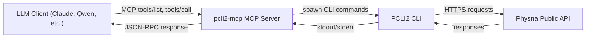

# pcli2-mcp

[](https://jchultarsky101.github.io/pcli2-mcp/)
[](LICENSE)
[](https://github.com/jchultarsky101/pcli2-mcp/actions/workflows/ci.yml)
[](https://github.com/jchultarsky101/pcli2-mcp/releases)

**Give AI agents eyes for 3D geometry.**

`pcli2-mcp` is a Model Context Protocol (MCP) server, written in Rust, that connects LLM clients — Claude, Qwen, local Ollama agents, or any MCP-capable app — to [Physna](https://www.physna.com)'s 3D geometry search. Agents can find geometrically similar parts, detect duplicates, match partial geometry, retrieve thumbnails, and manage asset metadata through natural conversation.

Ask your AI assistant:

> *"Find all parts in /Production that are at least 85% geometrically similar to bracket-v2.stl, and show me their thumbnails."*

…and it composes the right tool calls against your Physna tenant.

Project links:

- `pcli2-mcp`: https://github.com/jchultarsky101/pcli2-mcp
- `pcli2`: https://github.com/jchultarsky101/pcli2
- Hosted docs (Oranda): https://jchultarsky101.github.io/pcli2-mcp/

**Status:** current with **pcli2 2.8** (tool table last synced to pcli2 2.8.1).

## Architecture

PCLI2 (Physna Command Line Interface v2) is the official CLI for the Physna public API, focused on 3D geometry search and asset/folder operations. This project is an MCP wrapper around PCLI2: it runs PCLI2 commands behind an MCP JSON-RPC interface so LLM clients can invoke the same capabilities programmatically.

The flow:

1. An LLM client (Claude, Qwen, or another MCP-capable app) sends a tool request.
2. `pcli2-mcp` translates that request into a PCLI2 CLI call.
3. PCLI2 talks to the Physna API and returns results.
4. `pcli2-mcp` returns the structured response back to the LLM client.



### Why wrap the CLI instead of calling the API directly?

- **Single source of truth.** PCLI2 already encodes all Physna API behavior: authentication, tenancy, output formats, error handling. The MCP layer stays thin and never duplicates API logic.
- **Independent evolution.** MCP is a young, fast-moving protocol. Protocol churn lands in the wrapper; API changes land in the CLI. Neither breaks the other.
- **Auditability.** Every agent action corresponds to a reproducible CLI command a human could run by hand — useful when reviewing what an autonomous agent actually did.

### Designed for LLM ergonomics

- **Thumbnails as URLs, not blobs.** Image responses return a short-lived HTTP URL (~200 tokens) instead of base64 data (~50K tokens that models routinely mangle). See [Thumbnail Cache](#thumbnail-cache).
- **Granular tools with explicit arguments.** 30+ narrowly-scoped tools help models select the right operation and fill parameters reliably, instead of one mega-tool with a dozen optional flags.
- **Structured output.** CSV/JSON response formats keep results machine-readable for downstream reasoning.

## Quick Start

1. Install PCLI2 (version 2.0 or newer) and authenticate.
   Follow the PCLI2 docs and make sure `pcli2` is on your `PATH`: https://jchultarsky101.github.io/pcli2/
   Set `PCLI2_BIN` to point at a specific binary if it is not on the `PATH`.
2. Install `pcli2-mcp` (see Installation below).
3. Run the server:

   ```bash
   pcli2-mcp serve --host localhost --port 8080 --log-level info
   ```
4. Verify the server is healthy:

   ```bash
   curl -s http://localhost:8080/health
   ```
5. Validate MCP is responding (list tools):

   ```bash
   curl -s http://localhost:8080/mcp \
     -H "Content-Type: application/json" \
     -d '{
       "jsonrpc": "2.0",
       "id": 1,
       "method": "tools/list",
       "params": {}
     }'
   ```
6. Generate a client config snippet:

   ```bash
   pcli2-mcp config --client claude --host localhost --port 8080
   ```
7. Paste the snippet into your client (see the sections below).

## Installation

Recommended (pre-built binaries):

1. Download the latest release for your platform from:
   https://github.com/jchultarsky101/pcli2-mcp/releases
2. Put the `pcli2-mcp` binary somewhere on your `PATH`.

Build from source:

1. Install the Rust toolchain (edition 2024).
2. Build:

   ```bash
   cargo build --release
   ```

   The binary will be at `target/release/pcli2-mcp`.

## Documentation Site (Oranda)

This repository uses Oranda to render a nicer, hosted version of the README.

Local build:

```bash
oranda build
```

Local preview (auto-rebuilds on changes):

```bash
oranda dev
```

The GitHub Pages workflow (`.github/workflows/docs.yml`) publishes the site from `public/`.

## Features

- MCP over HTTP (`/mcp`) with JSON-RPC 2.0
- 85 MCP tools covering every pcli2 2.8 command: tenant, folder, asset, metadata, match/similarity, report, catalog, auth, config, environment, user, cache, a generic `api` passthrough, and doctor
- Declarative tool table: one spec per pcli2 command drives both the advertised JSON schema and the argv, with argument validation (required, enums, numeric ranges) before pcli2 is spawned
- pcli2 is always run non-interactively (`PCLI2_NO_INPUT`, `PCLI2_NO_COLOR`, `PCLI2_NO_UPDATE_CHECK`) with machine-readable errors (`PCLI2_ERROR_FORMAT=json`) rendered into tool error messages, `PCLI2_FORMAT=json` so every `--format` defaults to the machine-readable JSON that LLM clients consume, and `PCLI2_SAFE_CSV=1` so any CSV a tool emits is guarded against spreadsheet formula injection
- **Self-correcting errors**: a pcli2 run that fails (bad input, a lookup miss, a non-zero exit) is returned to the model as `isError: true` tool content, so it can read the message and retry — only malformed JSON-RPC (bad JSON, unknown method) raises a JSON-RPC error
- **Security**: optional `--token` / `MCP_TOKEN` bearer auth on `/mcp` (compared in constant time), and `--read-only` mode that refuses any tool that mutates Physna data, auth or config state (and constrains `pcli2_api` to `GET`/`HEAD`)
- **Secret hygiene**: the OAuth2 `client_secret` is forwarded to pcli2 via `PCLI2_CLIENT_SECRET` instead of argv, so it never appears in a process list or in the execution log
- **Thumbnail caching**: Thumbnails are cached on disk and served via HTTP URLs, avoiding large base64 payloads in MCP responses
- **Thumbnail cleanup tool**: Remove expired thumbnails to free up disk space
- Simple, single-binary Rust server
- Comprehensive test suite (unit tests with an argv case for every tool, plus integration tests against a mock pcli2 covering the error contract, read-only mode and auth)
- Modular code architecture (cli, error, mcp, pcli, tools, server, thumbnail)

## Client Setup (Using `config`)

The `config` command prints a ready-to-paste JSON snippet with the MCP server definition:

```bash
pcli2-mcp config --client claude --host localhost --port 8080
```

Use the output in the sections below.

## CLI

Run the server:

```bash
pcli2-mcp serve --host localhost --port 8080 --log-level info
```

Use `--host 0.0.0.0` to listen on all interfaces.

### Security

The `/mcp` endpoint can run any pcli2 command, including destructive ones, as the
user the server runs as — so never expose it unsecured. The default bind is
`localhost`, which is safe on its own. For anything else:

```bash
# Require a shared secret on every request, in read-only mode:
pcli2-mcp serve --host 0.0.0.0 --token "$(openssl rand -hex 24)" --read-only
```

- **Bearer token** (`--token <TOKEN>` or the `MCP_TOKEN` environment variable):
  when set, every `POST /mcp` request must send
  `Authorization: Bearer <TOKEN>` (compared in constant time); anything else gets
  `401`. When unset, the route is open — correct only for loopback.
- **Read-only** (`--read-only`): refuse every tool that mutates Physna data, an
  authentication session, or local config state (`*_create`, `*_delete`, `*_move`,
  `*_set`, `*_clear`, `*_import`, `env use`, `tenant use`, `auth …`, …). The generic
  `pcli2_api` passthrough is limited to `GET`/`HEAD` with no request body. Refusals
  are returned as `isError: true` content so the model can adapt.
  `pcli2_cache_clear` and `pcli2_thumbnail_cache_cleanup` stay allowed (local maintenance).
- **Secrets**: the OAuth2 `client_secret` is handed to pcli2 via the
  `PCLI2_CLIENT_SECRET` environment variable rather than on the command line, so it
  never shows up in a process list or in the execution log.

Print client config (pretty JSON):

```bash
pcli2-mcp config --client claude --host localhost --port 8080
```

Command-specific help:

```bash
pcli2-mcp help serve
```

### Claude Desktop

1. Open Claude Desktop and go to Settings > Developer > Edit Config (or open the config file directly).
2. Paste the JSON output under `mcpServers`.
3. Restart Claude Desktop.

Config file locations:

- macOS: `~/Library/Application Support/Claude/claude_desktop_config.json`
- Windows: `%APPDATA%\Claude\claude_desktop_config.json`
- Linux: `~/.config/Claude/claude_desktop_config.json`

### Qwen Code

Qwen Code reads MCP servers from `mcpServers` in `settings.json`. You can configure this via:

1. Edit `.qwen/settings.json` in your project, or `~/.qwen/settings.json` for user scope.
2. Paste the JSON output under `mcpServers`.
3. Restart Qwen Code for the settings to load.

Alternatively, you can add a server with the CLI:

```bash
qwen mcp add --transport http pcli2 http://localhost:8080/mcp
```

### Qwen Agent (Python)

Pass an MCP configuration dictionary (including `mcpServers`) when creating the agent:

```python
from qwen_agent.agents import Assistant

mcp_config = {
    "mcpServers": {
        "pcli2": {
            "command": "npx",
            "args": ["-y", "mcp-remote", "http://localhost:8080/mcp"]
        }
    }
}

agent = Assistant(
    llm=llm_cfg,
    function_list=[mcp_config],
)
```

### MCPHost (Local Ollama)

MCPHost can use a local Ollama model and connect to this MCP server over HTTP.

1. Install Ollama, pull a model, and make sure the daemon is running:

   ```bash
   ollama pull mistral
   ollama serve
   ```

2. Install MCPHost:

   ```bash
   go install github.com/mark3labs/mcphost@latest
   ```

3. Create a config file (preferred locations include `~/.mcphost.yml` or `~/.mcphost.json`) and point it at your local MCP server:

   ```yaml
   # ~/.mcphost.yml
   mcpServers:
     pcli2:
       type: "remote"
       url: "http://localhost:8080/mcp"

   # Use a local model with function-calling support
   model: "ollama:mistral"
   ```

4. Run MCPHost:

   ```bash
   mcphost -m ollama:qwen3 --config ./mcphost.yml
   ```

### Other MCP Clients

Most MCP-compatible clients accept the same `mcpServers` JSON block. Use the output of `pcli2-mcp config` as the server definition and follow your client's MCP documentation.

## MCP API

The server implements MCP over HTTP with a JSON-RPC 2.0 interface.

- `POST /mcp`
- Methods: `initialize`, `tools/list`, `tools/call`
- When authenticated, requests must carry `Authorization: Bearer <TOKEN>`; otherwise `/mcp` returns `401`.
- **Error contract**: a pcli2 run that fails is returned as a tool result with
  `isError: true` (and a `content[].text` message) so the calling model can read
  it and self-correct; only malformed requests and unknown methods raise a
  JSON-RPC error.

Example `tools/list`:

```json
{
  "jsonrpc": "2.0",
  "id": 1,
  "method": "tools/list",
  "params": {}
}
```

Example `tools/call` (list assets under `/Julian` as CSV):

```json
{
  "jsonrpc": "2.0",
  "id": 2,
  "method": "tools/call",
  "params": {
    "name": "pcli2",
    "arguments": {
      "resource": "asset",
      "folder_path": "/Julian",
      "format": "csv",
      "headers": true
    }
  }
}
```

## Tools

Notes:

- Tool names mirror the pcli2 command tree: `pcli2_<group>_<command>`.
- Most asset tools require either `uuid` or `path`; most folder tools require either `folder_uuid` or `folder_path`.
- Boolean flags such as `headers`, `pretty`, `metadata`, `progress`, `dry_run` map to the pcli2 flag of the same name. Mutating tools accept `yes` to auto-confirm prompts.
- File and directory arguments (`input`, `output`, `checkpoint`) refer to the filesystem of the host running `pcli2-mcp`.
- Output is **JSON by default** (`PCLI2_FORMAT=json` is set for every pcli2 call). Pass `format` as `"json"` (the default), `"csv"`, or — where the command supports it — `"tree"`/`"table"`/`"xls"`/`"xlsx"` to change it. For LLM work, keep it JSON.
- Argument values are validated (required keys, enums, numeric ranges) before pcli2 is spawned; violations return a JSON-RPC error without running anything.

| Tool | PCLI2 Command | Required Arguments |
| --- | --- | --- |
| `pcli2` | `pcli2 folder list` / `pcli2 asset list` (legacy combined tool) | `folder_path` or `folder_uuid` when `resource=asset` |
| `pcli2_version` | `pcli2 --version` | none |
| `pcli2_doctor` | `pcli2 doctor` | none |
| `pcli2_tenant_list` | `pcli2 tenant list` | none |
| `pcli2_tenant_get` | `pcli2 tenant get` | none |
| `pcli2_tenant_state` | `pcli2 tenant state` | none |
| `pcli2_tenant_use` | `pcli2 tenant use --name <name>` | `name` (or legacy `tenant_name`) |
| `pcli2_tenant_clear` | `pcli2 tenant clear` | none |
| `pcli2_tenant_metadata_list` | `pcli2 tenant metadata list` | none |
| `pcli2_tenant_failures` | `pcli2 tenant failures` | none |
| `pcli2_tenant_usage` | `pcli2 tenant usage` | none |
| `pcli2_folder_list` | `pcli2 folder list` | none |
| `pcli2_folder_get` | `pcli2 folder get` | `folder_uuid` or `folder_path` |
| `pcli2_folder_create` | `pcli2 folder create` | `name`, plus `parent_folder_uuid` or `parent_folder_path` (optional `description`) |
| `pcli2_folder_delete` | `pcli2 folder delete` | `folder_uuid` or `folder_path` |
| `pcli2_folder_rename` | `pcli2 folder rename` | `name`, plus `folder_uuid` or `folder_path` |
| `pcli2_folder_move` | `pcli2 folder move` | `folder_uuid` or `folder_path`, plus `parent_folder_uuid` or `parent_folder_path` |
| `pcli2_folder_description_get` | `pcli2 folder description get` | `folder_uuid` or `folder_path` |
| `pcli2_folder_description_set` | `pcli2 folder description set` | `text`, plus `folder_uuid` or `folder_path` |
| `pcli2_folder_description_clear` | `pcli2 folder description clear` | `folder_uuid` or `folder_path` |
| `pcli2_folder_resolve` | `pcli2 folder resolve` | `folder_path` |
| `pcli2_folder_download` | `pcli2 folder download` | `folder_uuid` or `folder_path` |
| `pcli2_folder_upload` | `pcli2 folder upload` | `input`, plus `folder_uuid` or `folder_path` |
| `pcli2_folder_thumbnail` | `pcli2 folder thumbnail` | `folder_uuid` or `folder_path` |
| `pcli2_folder_dependencies` | `pcli2 folder dependencies` | `folder_path` |
| `pcli2_folder_geometric_match` | `pcli2 folder geometric-match` | `folder_path` (optional `groups`, `format=xls`/`xlsx`) |
| `pcli2_folder_part_match` | `pcli2 folder part-match` | `folder_path` |
| `pcli2_folder_visual_match` | `pcli2 folder visual-match` | `folder_path` |
| `pcli2_auth_login` | `pcli2 auth login` | `client_id`, `client_secret` |
| `pcli2_auth_logout` | `pcli2 auth logout` | none |
| `pcli2_auth_get` | `pcli2 auth get` | none |
| `pcli2_auth_clear_token` | `pcli2 auth clear-token` | none |
| `pcli2_auth_expiration` | `pcli2 auth expiration` | none |
| `pcli2_asset_list` | `pcli2 asset list` | `folder_uuid` or `folder_path` |
| `pcli2_asset_get` | `pcli2 asset get` | `uuid` or `path` |
| `pcli2_asset_create` | `pcli2 asset create` | `input`, plus `folder_uuid` or `folder_path` |
| `pcli2_asset_create_batch` | `pcli2 asset create-batch` | `input`, plus `folder_uuid` or `folder_path` |
| `pcli2_asset_delete` | `pcli2 asset delete` | `uuid` or `path` |
| `pcli2_asset_download` | `pcli2 asset download` | `uuid` or `path` |
| `pcli2_asset_dependencies` | `pcli2 asset dependencies` | `uuid` or `path` |
| `pcli2_asset_dependency_diff` | `pcli2 asset dependency-diff` | `reference_uuid` or `reference_path`, plus `candidate_uuid` or `candidate_path` |
| `pcli2_asset_geometric_match` | `pcli2 asset geometric-match` | `uuid` or `path` |
| `pcli2_geometric_match` | `pcli2 asset geometric-match` (legacy alias) | `uuid` or `path` |
| `pcli2_asset_part_match` | `pcli2 asset part-match` | `uuid` or `path` |
| `pcli2_asset_visual_match` | `pcli2 asset visual-match` | `uuid` or `path` |
| `pcli2_asset_text_match` | `pcli2 asset text-match` | `text` |
| `pcli2_asset_similarity` | `pcli2 asset similarity` | `reference_uuid` or `reference_path`, plus `candidate_uuid` or `candidate_path` |
| `pcli2_asset_reprocess` | `pcli2 asset reprocess` | `uuid` or `path` |
| `pcli2_asset_resolve_dependency` | `pcli2 asset resolve-dependency` | `dependency`, plus `uuid` or `path`, plus `target_uuid` or `target_path` |
| `pcli2_asset_move` | `pcli2 asset move` | `uuid` or `path`, plus `folder_uuid` or `folder_path` |
| `pcli2_asset_diagnose` | `pcli2 asset diagnose` | `uuid` or `path` |
| `pcli2_asset_counts` | `pcli2 asset counts` | none |
| `pcli2_asset_inventory` | `pcli2 asset inventory` | none |
| `pcli2_asset_thumbnail` | `pcli2 asset thumbnail` | `uuid` or `path` |
| `pcli2_asset_metadata_get` | `pcli2 asset metadata get` | `uuid` or `path` |
| `pcli2_asset_metadata_create` | `pcli2 asset metadata create` | `name`, `value`, plus `uuid` or `path` |
| `pcli2_asset_metadata_delete` | `pcli2 asset metadata delete` | `name`, plus `uuid` or `path` |
| `pcli2_asset_metadata_create_batch` | `pcli2 asset metadata create-batch` | `input` |
| `pcli2_asset_metadata_inference` | `pcli2 asset metadata inference` | `path`, `name` |
| `pcli2_config_get` | `pcli2 config get` | none |
| `pcli2_config_get_path` | `pcli2 config get path` | none |
| `pcli2_config_validate` | `pcli2 config validate` | none |
| `pcli2_config_export` | `pcli2 config export` | none |
| `pcli2_config_import` | `pcli2 config import` | none |
| `pcli2_environment_list` | `pcli2 env list` | none |
| `pcli2_environment_get` | `pcli2 env get` | none |
| `pcli2_environment_use` | `pcli2 env use --name <name>` | `name` |
| `pcli2_environment_add` | `pcli2 env add --name <name> [--api-url ...] [--ui-url ...] [--auth-url ...]` | `name` |
| `pcli2_environment_remove` | `pcli2 env remove --name <name>` | `name` |
| `pcli2_environment_reset` | `pcli2 env reset` | none |
| `pcli2_user_list` | `pcli2 user list` | none |
| `pcli2_user_get` | `pcli2 user get <user_id>` | `user_id` |
| `pcli2_report_list` | `pcli2 report list` | none |
| `pcli2_report_get` | `pcli2 report get` | `id` |
| `pcli2_report_download` | `pcli2 report download` | `id`, plus `format` (`csv`/`xlsx`/`table`) |
| `pcli2_report_diagnose` | `pcli2 report diagnose` | `id` |
| `pcli2_report_delete` | `pcli2 report delete` | `id` |
| `pcli2_report_create` | `pcli2 report create` | `folder_path` (repeatable) |
| `pcli2_catalog_list` | `pcli2 catalog list` | none |
| `pcli2_catalog_geometric_match` | `pcli2 catalog geometric-match` | `uuid` or `path` |
| `pcli2_catalog_part_match` | `pcli2 catalog part-match` | `uuid` or `path` |
| `pcli2_catalog_visual_match` | `pcli2 catalog visual-match` | `uuid` or `path` |
| `pcli2_api` | `pcli2 api <path>` | `path` |
| `pcli2_cache_clear` | `pcli2 cache clear` | none |
| `pcli2_thumbnail_cache_cleanup` | Cleanup expired thumbnails in the MCP server's cache | none |

Run `tools/list` for the full argument schema of each tool.

Example:

```json
{
  "jsonrpc": "2.0",
  "id": 3,
  "method": "tools/call",
  "params": {
    "name": "pcli2_geometric_match",
    "arguments": {
      "path": "/Root/Folder/Part.stl",
      "threshold": 85,
      "format": "csv",
      "headers": true
    }
  }
}
```

## Thumbnail Cache

The `pcli2_asset_thumbnail` tool uses a disk-based cache to serve thumbnails efficiently. It supports two response modes via the `response_mode` parameter.

> **⚠️ Recommended: Use `response_mode="url"` (default)**
>
> For LLM workflows, **always prefer `url` mode**. It returns a short HTTP URL (~200 tokens) that the client fetches automatically. The `data_url` mode returns ~50K tokens of base64 data, which LLMs often mangle, truncate, or re-encode incorrectly.

### Response Modes

| Mode | Description | Token Usage | When to Use |
|------|-------------|-------------|-------------|
| `url` (default) | Returns an HTTP URL like `http://localhost:8080/thumbnail/:cache_key` | ~200 tokens | **Recommended for all LLM workflows.** The client fetches the image via HTTP automatically. Images render correctly in markdown without LLM handling the image data. |
| `data_url` | Returns a base64 data URI like `data:image/png;base64,...` | ~50K tokens | **Not recommended for LLM use.** Only use when the client cannot make HTTP requests. LLMs often corrupt large base64 strings, causing broken or mangled images. |

### Usage Examples

**Efficient mode (default, recommended):**
```json
{
  "jsonrpc": "2.0",
  "id": 4,
  "method": "tools/call",
  "params": {
    "name": "pcli2_asset_thumbnail",
    "arguments": {
      "path": "/Root/Folder/Part.stl"
    }
  }
}
```

**Self-contained mode (not recommended for LLM):**
```json
{
  "jsonrpc": "2.0",
  "id": 4,
  "method": "tools/call",
  "params": {
    "name": "pcli2_asset_thumbnail",
    "arguments": {
      "path": "/Root/Folder/Part.stl",
      "response_mode": "data_url"
    }
  }
}
```

### How It Works

When you call `pcli2_asset_thumbnail`:
1. The server generates the thumbnail using PCLI2
2. Saves it to the cache directory with metadata
3. Returns an HTML snippet with an `` tag pointing to either:
   - A cached HTTP URL (`response_mode="url"`) - **recommended**
   - An embedded base64 data URI (`response_mode="data_url"`) - **not recommended for LLM**

### Cache Details

- **Cache location**: `~/.pcli2-mcp/thumbnails/`
- **Default TTL**: 24 hours
- **HTTP endpoint**: `http://localhost:PORT/thumbnail/:cache_key`

### Cleaning Up Expired Thumbnails

Use the `pcli2_thumbnail_cache_cleanup` tool to remove expired thumbnails and free up disk space:

```json
{
  "jsonrpc": "2.0",
  "id": 4,
  "method": "tools/call",
  "params": {
    "name": "pcli2_thumbnail_cache_cleanup",
    "arguments": {}
  }
}
```

## Examples

Each example below is a `tools/call` request sent to `POST /mcp`. Output is JSON by default — read it, don't parse human text.

**Run a duplication report and wait for it to finish:**

```json
{
  "jsonrpc": "2.0",
  "id": 5,
  "method": "tools/call",
  "params": {
    "name": "pcli2_report_create",
    "arguments": {
      "name": "Q3 duplicate parts",
      "folder_path": ["/Production", "/Suppliers"],
      "min_threshold": 90,
      "max_threshold": 100,
      "exclude_assemblies": true,
      "wait": true
    }
  }
}
```

Then download the finished report as an Excel file:

```json
{
  "jsonrpc": "2.0",
  "id": 6,
  "method": "tools/call",
  "params": {
    "name": "pcli2_report_download",
    "arguments": { "id": "7c51ca0f-7cbe-413a-a8e8-0d4f4b131e17", "format": "xlsx", "output": "./duplicates.xlsx" }
  }
}
```

**Search a supplier catalog for parts similar to your bracket:**

```json
{
  "jsonrpc": "2.0",
  "id": 7,
  "method": "tools/call",
  "params": {
    "name": "pcli2_catalog_geometric_match",
    "arguments": {
      "path": "/Production/bracket.stl",
      "in": "catalog",
      "threshold": 90,
      "format": "json"
    }
  }
}
```

**Fix a failed assembly by linking its missing dependency:**

```json
{
  "jsonrpc": "2.0",
  "id": 8,
  "method": "tools/call",
  "params": {
    "name": "pcli2_asset_resolve_dependency",
    "arguments": {
      "path": "/BOM/housing.step",
      "dependency": "/Suppliers/bolt.stl",
      "target_path": "/Production/bolt.stl",
      "dry_run": true
    }
  }
}
```

**Call any API endpoint directly (the `pcli2_api` escape hatch):**

```json
{
  "jsonrpc": "2.0",
  "id": 9,
  "method": "tools/call",
  "params": {
    "name": "pcli2_api",
    "arguments": {
      "path": "/tenants/{tenantId}/folders",
      "method": "GET",
      "paginate": true
    }
  }
}
```

## Configuration

`pcli2-mcp serve` options:

- `--host`: binding host (default: `localhost`); use `0.0.0.0` to listen on all interfaces
- `--port` / `-p`: listening port (default: `8080`)
- `--log-level`: logging level for the server (default: `info`)
- `--read-only`: refuse tools that mutate Physna data, auth or config state, and limit `pcli2_api` to `GET`/`HEAD` requests with no body
- `--token` <TOKEN>: require `Authorization: Bearer <TOKEN>` on every `/mcp` request
- `MCP_TOKEN`: environment-variable form of `--token`, used when `--token` is not given
- `RUST_LOG`: overrides `--log-level` when set

Environment `serve` also forwards to every pcli2 child process:
`PCLI2_NO_INPUT=1`, `PCLI2_NO_COLOR=1`, `PCLI2_NO_UPDATE_CHECK=1`,
`PCLI2_ERROR_FORMAT=json`, `PCLI2_FORMAT=json`, `PCLI2_SAFE_CSV=1`.

## Troubleshooting

- Ensure `pcli2` is installed and reachable via `PATH`.
- A tool result with `isError: true` (not a JSON-RPC error) means the pcli2 call
  ran and did not succeed — read the `error` text, fix the arguments, and retry.
- A `401` from `/mcp` means a token is required but missing or wrong; check
  `--token` / `MCP_TOKEN` and the client's `Authorization: Bearer …` header.
- A result refused as "read-only" means `--read-only` is set; drop it, or use a
  non-mutating / dry-run tool.
- If the server returns a non-zero error, check the embedded `pcli2` stdout/stderr in the response.
- For verbose logging during troubleshooting, set `RUST_LOG=debug`.

## Contributing

Issues and pull requests are welcome. If you plan significant changes, open an issue first
so we can discuss scope and approach.

## Getting Help

Open an issue with a clear repro, expected behavior, and logs (set `RUST_LOG=debug` if needed).

## Maintainers

Maintained by [Julian Chultarsky](https://github.com/jchultarsky101).

## Changelog

See `CHANGELOG.md`.

## License

Apache License 2.0. See `LICENSE` and `NOTICE`.
